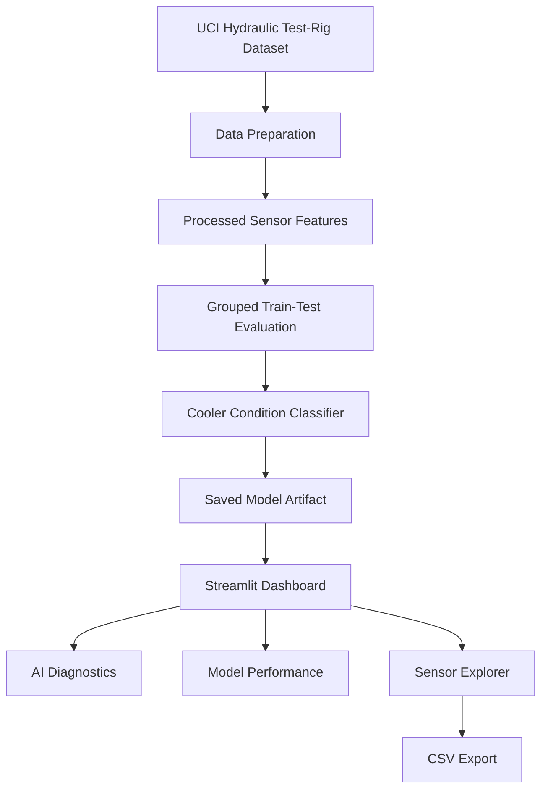

# Smart Excavator Guardian
### AI-Driven Hydraulic Condition Monitoring, Fault Diagnosis & Predictive Maintenance

<p align="center">
  <strong>An intelligent condition-monitoring research prototype combining machine learning, hydraulic sensor analytics, and interactive diagnostics.</strong>
</p>

<p align="center">
  
  
  
  
  
</p>

---

## 1. Project Overview

Hydraulic systems are essential to heavy machinery, enabling the controlled movement and force required for demanding operations. Changes in component condition can affect operating efficiency, equipment availability, and maintenance requirements.

**Smart Excavator Guardian** is a machine-learning-based research prototype that explores hydraulic condition classification through sensor data analysis and an interactive diagnostic dashboard.

The current implementation uses the **UCI Condition Monitoring of Hydraulic Systems dataset** to classify hydraulic cooler condition. It combines data preparation, supervised machine learning, model evaluation, and interactive visualization in a single Python application.

The dashboard allows users to inspect recorded sensor readings, obtain model predictions for selected cycles, examine classification performance, visualize feature importance, and export selected data for further analysis.

The long-term vision is to investigate how these capabilities could support excavator-oriented condition monitoring and predictive maintenance.

> **Current scope:** This is a software research prototype evaluated using hydraulic test-rig data. It is not connected to a real excavator, and its predictions have not been validated for real-world maintenance or safety-critical decisions.

## 2. Problem Statement

Traditional maintenance approaches may depend on scheduled servicing or inspections after equipment symptoms become apparent. Machine-learning-based condition monitoring offers a way to investigate whether sensor measurements contain useful patterns associated with component condition.

This project addresses the following research question:

**Can engineered features derived from recorded hydraulic sensor cycles be used to classify hydraulic cooler condition and present the resulting predictions through an interactive diagnostic system?**

The project establishes an initial experimental baseline and a software foundation for further research into hydraulic fault diagnosis.

## 3. Project Objectives

- Prepare and organize recorded hydraulic sensor data for machine-learning experiments.
- Develop a supervised classifier for hydraulic cooler condition.
- Evaluate the model using accuracy, precision, recall, F1-score, and a confusion matrix.
- Examine model-derived feature importance.
- Develop an interactive dashboard for model inference and sensor exploration.
- Support selected sensor-data exports for further analysis.
- Establish a foundation for future research involving additional components, time-series analysis, and independent validation.

## 4. System Architecture

The current implementation follows this software workflow:



### Workflow explanation

1. **Data acquisition:** use recorded measurements from the public hydraulic test-rig dataset.
2. **Data preparation:** organize the measurements into a structured feature table.
3. **Model development:** train a supervised classifier for the cooler-condition target.
4. **Evaluation:** assess the model on a grouped test split and generate evaluation reports.
5. **Model persistence:** save the trained model for reuse by the dashboard.
6. **Interactive diagnostics:** allow users to select recorded cycles and inspect predictions.
7. **Data visualization:** explore sensor readings, model performance, and feature importance.

The architecture represents the implemented software pipeline. Real-time telemetry, physical excavator integration, and a validated digital twin are future development goals.

## 5. Dataset Description

The project uses the **Condition Monitoring of Hydraulic Systems** dataset from the UCI Machine Learning Repository.

- **Dataset source:** UCI Machine Learning Repository
- **Experimental environment:** hydraulic test rig
- **Data type:** multivariate hydraulic-system sensor measurements
- **Processed dataset size:** 2,205 rows and 68 columns
- **Missing values in the processed table:** 0
- **Duplicate rows in the processed table:** 0
- **Current prediction target:** hydraulic cooler condition

Dataset link: [Condition Monitoring of Hydraulic Systems — UCI](https://archive.ics.uci.edu/dataset/447/condition+monitoring+of+hydraulic+systems)

The source dataset includes measurements associated with hydraulic operating conditions and component behaviour. The current model focuses on the cooler-condition target rather than diagnosing every component in the system.

### Cooler-condition classes

| Label | Condition |
|---|---|
| `3` | Cooler close to total failure |
| `20` | Reduced cooler efficiency |
| `100` | Full cooler efficiency |

These values are dataset condition labels. They are not prediction-confidence percentages.

**Domain limitation:** the dataset represents a controlled hydraulic test rig, not an operating excavator. Applying this model to excavator machinery would require suitable field data and additional validation.

## 6. Machine-Learning Methodology

### 6.1 Data preparation

The data preparation workflow produces a structured feature table for training and dashboard use.

The current processed data passed these integrity checks:

- 2,205 rows
- 68 columns
- 0 missing values
- 0 duplicate rows

These checks confirm basic data integrity but do not, by themselves, establish that the dataset is free from leakage or bias.

### 6.2 Model training and evaluation

The current experiment uses supervised classification to predict one of three cooler-condition labels.

| Setting | Current configuration |
|---|---|
| Evaluation strategy | `GroupShuffleSplit` |
| Test fraction | 20% |
| Random state | 42 |
| Target | Cooler condition |
| Number of classes | 3 |

The grouped split is intended to keep complete profile groups together when separating training and test data.

The reported metrics are from one experimental split. Repeated grouped evaluation and independent testing are needed to better understand the model's stability and generalization.

### 6.3 Evaluation metrics

- **Accuracy:** proportion of test examples classified correctly.
- **Precision:** proportion of predictions for a class that are correct.
- **Recall:** proportion of actual examples of a class that are identified.
- **F1-score:** harmonic mean of precision and recall.
- **Confusion matrix:** shows correct and incorrect classifications by class.
- **Feature importance:** indicates which features the fitted model identifies as influential, according to its importance method.

## 7. Experimental Results

The current grouped test evaluation achieved **82.36% accuracy**.

### Classification report

| Cooler label | Precision | Recall | F1-score | Test support |
|---|---:|---:|---:|---:|
| `3` — Close to total failure | 1.00 | 0.71 | 0.83 | 312 |
| `20` — Reduced efficiency | 0.54 | 1.00 | 0.70 | 101 |
| `100` — Full efficiency | 0.94 | 1.00 | 0.97 | 103 |

*Metrics are from the current saved evaluation report and are rounded to two decimal places.*

### Interpretation

- **Label 3:** Precision is 1.00, while recall is 0.71. Some actual examples of this condition were missed by the model.
- **Label 20:** Recall is 1.00, but precision is 0.54. The model identified all test examples in this class but also incorrectly assigned this label to examples from other classes.
- **Label 100:** Precision is 0.94 and recall is 1.00 on this test split.

These results demonstrate why class-wise metrics matter alongside overall accuracy. A model may achieve reasonable overall accuracy while still making important errors for particular classes.

**Research interpretation:** The result is an initial experimental baseline, not evidence of field-ready fault diagnosis. Additional grouped evaluations, leakage checks, and independent testing are needed before drawing broader conclusions.

## 8. Interactive Dashboard

The Streamlit application provides four main sections.

### System Overview
A starting point for navigating the condition-monitoring prototype.

### AI Diagnostics
Select a recorded sensor cycle and inspect the cooler-condition prediction produced by the saved model.

### Model Performance
Examine the stored classification report, confusion matrix, evaluation metrics, and feature-importance visualization.

### Sensor Explorer
Explore available sensor features, inspect readings and statistics, select a cycle range, visualize measurements, and export selected readings to CSV.

The dashboard currently uses recorded data and a saved model artifact. It does not receive live excavator sensor readings.

## 9. Dashboard Screenshots

Screenshots of the working application can be added here to help reviewers understand the implementation quickly.

Once screenshots have been saved in a repository folder named `screenshots`, replace the placeholders below with the corresponding image filenames.

### System Overview
``

### AI Diagnostics
``

### Model Performance
``

### Sensor Explorer
``

*Add the screenshot files before enabling these image links in the published README.*

## 10. Technology Stack

| Technology | Purpose |
|---|---|
| Python | Application development and machine learning |
| Pandas | Data processing and tabular analysis |
| NumPy | Numerical operations |
| Scikit-learn | Classification and model evaluation |
| Matplotlib | Evaluation visualizations |
| Plotly | Interactive data visualization |
| Streamlit | Interactive dashboard |
| Joblib | Model artifact persistence |
| Git | Source-code version control |

## 11. Repository Structure

```text
smart-excavator-guardian/
├── data/
│   ├── raw/
│   └── processed/
│       └── sensor_features.csv
├── models/
│   └── cooler_condition_model.joblib
├── reports/
│   └── figures/
│       ├── cooler_classification_report.csv
│       ├── cooler_confusion_matrix.csv
│       └── cooler_feature_importance.csv
├── src/
│   ├── dashboard.py
│   └── prepare_data.py
├── tests/
├── .env.example
├── .gitignore
├── LICENSE
├── README.md
└── requirements.txt
```

This is the intended repository layout. Confirm that each listed file or folder exists before treating the tree as an exact representation of the published repository. Raw dataset files should be included only when appropriate under the dataset's terms and repository size constraints.

## 12. Installation and Execution

### Prerequisites

- Python 3.12
- Git
- A terminal such as Windows PowerShell
- The required processed dataset and saved model artifact

### Step 1: Clone the repository

After creating the GitHub repository, replace the placeholder with its actual URL.

```bash
git clone <YOUR_GITHUB_REPOSITORY_URL>
cd smart-excavator-guardian
```

### Step 2: Create a virtual environment

On Windows PowerShell:

```powershell
python -m venv .venv
.\.venv\Scripts\Activate.ps1
```

### Step 3: Install dependencies

```powershell
python -m pip install --upgrade pip
pip install -r requirements.txt
```

### Step 4: Start the dashboard

```powershell
streamlit run src/dashboard.py
```

Streamlit will display a local URL in the terminal. Open that URL in your browser.

### Reproducibility note

The dashboard expects the processed feature table and saved model at the paths specified by the application. A fresh setup also requires the appropriate data-preparation inputs if the processed table is not included.

The installation instructions should be verified in a clean environment before the project is described as fully reproducible.

## 13. Research Limitations

The current implementation has the following limitations:

1. **Test-rig data:** the model has not been trained or validated on actual excavator field data.
2. **Limited prediction target:** the current classifier focuses on hydraulic cooler condition.
3. **Single evaluation split:** the reported accuracy is from one grouped train-test evaluation.
4. **Generalization uncertainty:** performance across other machines, operating conditions, sensor configurations, and environments is unknown.
5. **No live integration:** live sensor ingestion, hardware integration, and edge deployment have not been demonstrated.
6. **No validated remaining-useful-life prediction:** the current system classifies cooler condition; it does not estimate the remaining useful life of a component.
7. **Safety considerations:** the model must not be used as the sole basis for operational or safety-critical maintenance decisions.

The system is intended for educational, experimental, and research-development purposes.

## 14. Future Research Roadmap

### Phase 1 — Improve model reliability
- Perform repeated grouped train-test evaluations.
- Investigate misclassified examples and class-wise errors.
- Check for data leakage and evaluate appropriate baseline models.
- Document preprocessing and feature definitions.

### Phase 2 — Expand condition monitoring
- Investigate additional component-condition targets.
- Explore time-series features and anomaly detection.
- Examine prediction confidence and calibration.
- Improve explanations of individual model predictions.

### Phase 3 — Develop an excavator-oriented monitoring prototype
- Identify suitable hydraulic sensors and telemetry interfaces.
- Collect or obtain appropriately authorized field data.
- Investigate differences between test-rig and field measurements.
- Develop and test a simulated telemetry interface before hardware integration.

### Phase 4 — Explore digital-twin integration
- Define a digital representation of the monitored hydraulic system.
- Add timestamped telemetry and component-state tracking.
- Compare model predictions with independent observations.
- Evaluate the approach under representative operating conditions.

These items are proposed future work, not claims about completed functionality.

## 15. Dataset Citation

Helwig, N., Pignanelli, E., & Schütze, A. (2015). *Condition monitoring of hydraulic systems* [Dataset]. UCI Machine Learning Repository.

- Dataset: https://archive.ics.uci.edu/dataset/447/condition+monitoring+of+hydraulic+systems
- DOI: https://doi.org/10.24432/C5CW21

Please consult the original dataset record for its licensing and attribution requirements.

## 16. Project Status

**Status:** Research and demonstration prototype.

The current implementation includes processed sensor features, a saved hydraulic cooler-condition classifier, an interactive Streamlit dashboard, and preliminary model-evaluation artifacts.

The next priorities are stronger experimental validation, improved reproducibility, and investigation of how the approach could be extended to representative excavator data.

## 17. Author and Contributions

Developed as an engineering project exploring machine learning, hydraulic condition monitoring, fault classification, and interactive sensor-data visualization.

Technical feedback, research discussion, and reproducibility improvements are welcome.

---

**Keywords:** Hydraulic Condition Monitoring · Machine Learning · Fault Classification · Predictive Maintenance Research · Sensor Analytics · Streamlit · Heavy Equipment · Digital Twin Research
